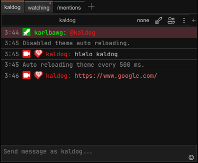

<h1 align="center">Ashen for Chatterino</h1>

> _**Let the fire fade — not your focus**._
>
> _Designed for long nights and longer thoughts._

[Ashen](https://codeberg.org/ficd/ashen) is a warm, muted theme born from the glow of dying embers — rich in reds, orange highlights, and layers of gray. Inspired by Dark Souls III, it's crafted to be gentle on the eyes and steady on the mind. Whether you're deep in the terminal or writing code by candlelight — Ashen offers a calm, focused atmosphere for development after dark.

### Installation
To install Ashen for Chatterino, download the `Ashen.json` file and place it in the Themes folder within [the Chatterino folder](https://wiki.chatterino.com/Settings/#where-is-my-chatterino-folder-located).

Then (re)open Chatterino and navigate to `Settings > General > Interface > Theme:` and change the setting to `Custom: Ashen`.
